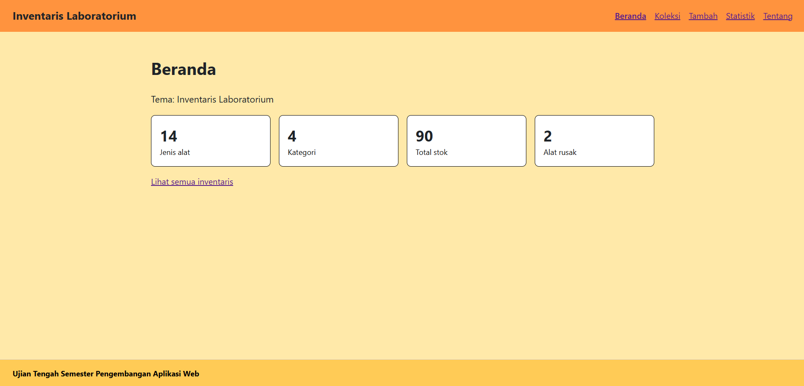
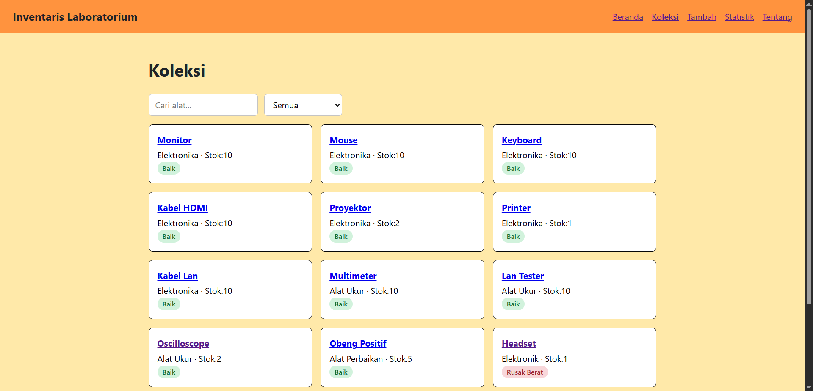
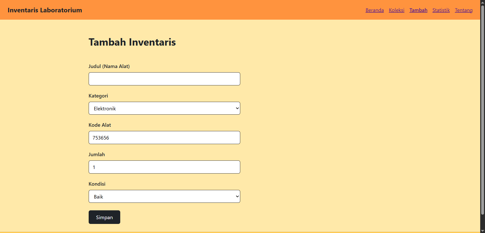

# Ujian Tengah Semester IF25-22014 Pengembangan Aplikasi Web

# Inventaris Laboratorium

Nama: ROBERTO CHARLOS SAGALA  
NIM: 123140113  
Kelas: RB  
Tema: Inventaris Laboratorium  
Deployment: https://charlos1002.github.io/uts-paw/  

## Tangkapan Layar
  
  
  

## Fitur
- Mencatat dan Menyimpan Alat Laboratorium  
- Menambahkan dan Menghapus Alat Laboratorium  
- Dashboard Alat Laboratorium yang sudah dikelompokan berdasarkan Kategori
- Mencari Alat laboratorium berdasarkan nama maupun kategori


## Menjalankan secara lokal
```
cd app
npm install
npm run dev
```
## Konsep React yang dipakai

- JSX
- Props
- useState
- useEffect
- useContext
- Context API
- Custom Hooks
- Local Storage
- React Testing
